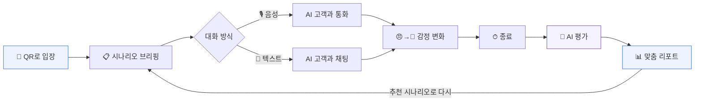
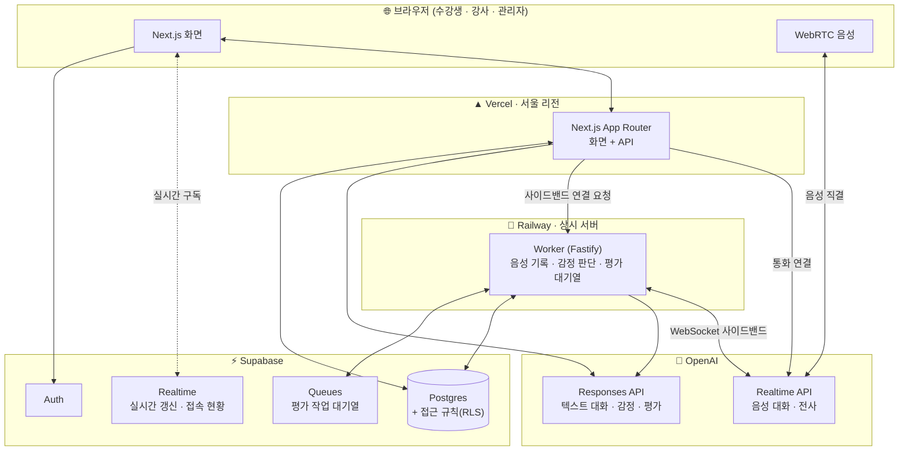

<div align="center">

# 🎧 인허브 리허설

### 실전 같은 고객 응대, 실전 전에 충분히.

**AI 고객과 음성·텍스트로 응대를 연습하고, 대화가 끝나는 즉시 근거가 담긴 맞춤 리포트를 받는 CS 교육 실습 플랫폼**

<br/>


<br/>


[핵심 기능](#-핵심-기능) · [실습 흐름](#-실습-한-번의-흐름) · [리포트](#-대화가-끝나면-바로-리포트) · [아키텍처](#-아키텍처) · [시작하기](#-시작하기)

</div>

<br/>

## 💡 왜 만들었나요

CS 교육에서 가장 효과적인 방법은 **직접 해 보는 것**입니다. 하지만 교실의 롤플레이에는 늘 한계가 있었습니다.

| 기존 롤플레이 | 인허브 리허설 |
|:--|:--|
| 동료가 고객 역할 → 몰입이 어렵고 감정 연기가 들쑥날쑥 | **시나리오대로 반응하는 AI 고객**이 응대 방식에 따라 실제로 화를 내거나 누그러짐 |
| 30명이 순서를 기다리며 한두 번 연습 | **30명이 동시에**, 원하는 만큼 반복 연습 |
| 피드백은 강사의 기억과 메모에 의존 | 모든 발화가 기록되고 **근거 발화를 짚어 주는** 평가 리포트 |
| 반 전체 상황을 한눈에 보기 어려움 | 강사 대시보드에서 **실시간으로** 누가 막혔는지 확인 |

<br/>

## ✨ 핵심 기능

<table>
<tr>
<td width="33%" valign="top">

### 🙋 수강생

- **QR 하나로 입장**: 입장 코드나 QR로 바로 교육에 참여
- **시나리오 브리핑**: 상황, 고객 정보, 목표를 확인한 뒤 시작
- **음성 또는 텍스트 대화**: 실제 전화처럼 말로, 혹은 채팅으로
- **실시간 고객 감정 표시**: 내 응대에 고객이 어떻게 반응하는지 바로 확인
- **즉시 리포트**: 점수, 역량, 잘한 점, "이렇게 말해 보세요"
- **연습 기록 대시보드**: 차수별 점수 추이, 역량 레이더(나 vs 평균), 시나리오별 최고점

</td>
<td width="33%" valign="top">

### 🧑‍🏫 강사

- **교육 차수 운영**: 만들기, 수정, 복제, 보관
- **실습 제어**: 시작, 일시정지, 종료, 전체 공지
- **실시간 모니터링**: 접속 현황과 대화 진행, **도움이 필요한 수강생을 맨 앞에**
- **대화 실시간 열람**: 진행 중인 대화를 그대로 지켜보기
- **코멘트와 점수 보정**: 리포트에 강사 의견 덧붙이기
- **반 전체 분석**: 역량별 평균, AI 요약, 디브리핑 발표 화면, Excel 내보내기

</td>
<td width="33%" valign="top">

### 🛠 운영 관리자

- **시나리오 편집기**: 고객 성격, 숨은 사정, 필수 절차, 평가 기준까지 직접 설계
- **버전 관리**: 수정할 때마다 새 버전으로 쌓이고, 진행 중인 교육은 기존 버전 유지
- **테스트 플레이**: 공개 전에 직접 대화해 보기
- **사용자·권한 관리**
- **비용 대시보드**: 차수별 추정 비용과 **OpenAI 실제 청구액** 비교

</td>
</tr>
</table>

<br/>

## 🔄 실습 한 번의 흐름



### AI 고객은 이렇게 움직입니다

- 🎭 **시나리오대로 연기해요.** 업종, 고객 성격, 처음 감정, **말하지 않은 속사정**까지 시나리오에 정의된 대로 반응합니다.
- 📈 **감정이 변해요.** 고객이 말할 때마다 감정을 다시 판단합니다(매우 화남 → 화남 → 불만 → 약간 불만 → 차분). 공감하고 해결책을 내면 누그러지고, 형식적으로 대응하면 더 화를 냅니다.
- 🚪 **고객이 먼저 끊기도 해요.** 감정이 끝까지 나빠지면 고객이 대화를 끝냅니다. 실전처럼요.
- 🎙 **진짜 통화처럼 말해요.** OpenAI Realtime 음성으로 끼어들기와 즉각 응답이 가능한 자연스러운 음성 대화를 합니다.

<br/>

## 📊 대화가 끝나면 바로 리포트

> 점수만 주는 평가가 아닙니다. **"어느 발화가 왜 좋았고, 어떻게 바꾸면 더 좋은지"** 를 실제 대화를 근거로 알려 줍니다.

| 구성 | 내용 |
|:--|:--|
| 🏅 **등급과 총점** | S / A / B / C / D와 100점 만점 점수 |
| 🕸 **7대 역량 점수** | 인사·표준 절차, 경청·니즈 파악, 공감·감정 관리, 문제 해결·대안 제시, 정확성·정책 준수, 언어 표현, 음성 전달력 |
| ✅ **필수 절차 체크리스트** | 본인 확인, 규정 안내처럼 시나리오가 요구한 절차를 지켰는지 |
| 📉 **고객 감정 그래프** | 대화 내내 고객 감정이 어떻게 오르내렸는지 |
| 👍 **잘한 점** | 실제 발화를 인용해서 |
| ✍️ **개선할 점** | 문제 발화와 **"이렇게 말해 보세요"** 대체 문장 |
| 🎯 **다음 연습 추천** | 약한 역량을 연습할 수 있는 다른 시나리오 |

평가 AI가 인용한 발화가 실제 대화에 있는지 서버가 검증합니다. 근거 없는 평가가 나오면 다시 평가합니다.

<br/>

## 🏗 아키텍처



**설계 포인트**

- **음성은 브라우저와 OpenAI가 직접 연결됩니다(WebRTC).** 서버를 거치지 않아 지연이 적고, 서버는 별도 사이드밴드 연결로 대화를 기록하고 감정을 판단합니다.
- **평가는 대기열로 처리합니다.** 실습 종료와 함께 30명의 대화가 한꺼번에 끝나도 평가가 순서대로, 실패 시 재시도하며 처리됩니다.
- **화면은 실시간으로 갱신됩니다.** 강사 대시보드, 대화 열람, 리포트 대기 화면이 새로고침 없이 바로 바뀝니다.
- **권한은 DB가 지킵니다.** 수강생은 자기 기록만, 강사는 담당 차수만 볼 수 있도록 DB 접근 규칙(RLS)으로 막습니다.

<br/>

## 🧰 기술 스택

| 영역 | 기술 |
|:--|:--|
| **화면** | Next.js 15 (App Router) · React 19 · Tailwind CSS v4 · Recharts |
| **서버** | Next.js Route Handlers · Fastify 5 (Worker) · WebSocket |
| **데이터** | Supabase Postgres · Realtime · Queues(pgmq) · Auth |
| **AI** | OpenAI Realtime API (`gpt-realtime-2.1-mini`) · Responses API (`gpt-5-mini`) · Structured Outputs · `gpt-4o-mini-transcribe` |
| **검증** | Zod: AI 응답과 입력값의 형식 검사를 공유 패키지 하나로 |
| **배포** | Vercel (화면, 서울 리전) · Railway (상시 서버) · GitHub 연동 자동 배포 |
| **언어·구조** | TypeScript 단일 언어 · npm workspaces 모노레포 |

<br/>

## 🎬 기본 제공 시나리오

| 업종 | 시나리오 | 고객 |
|:--:|:--|:--|
| 🏛 공공 | **여권 발급 지연 민원** | 출국이 코앞인데 여권이 안 나온 민원인 |
| 🏥 의료 | **건강검진 예약 변경 요청** | 일정이 꼬여 급하게 날짜를 바꿔야 하는 고객 |
| 💳 금융 | **해외 결제 승인 거절 항의** | 해외 현지에서 카드가 막혀 당황한 고객 |
| 🛡 보험 | **보험금 지급 지연 문의** | 서류를 다 냈는데 보험금이 안 들어온 고객 |

운영 관리자가 시나리오 편집기로 고객사 상황에 맞는 시나리오를 얼마든지 추가할 수 있습니다.

<br/>

## 📁 프로젝트 구조

```
inhub-rehearsal/
├── apps/
│   ├── web/          # 화면과 API (Next.js) → Vercel
│   │   └── src/
│   │       ├── app/          # 화면: learn(수강생) · instructor(강사) · admin(관리자) · api
│   │       ├── components/   # 화면 조각: 대화, 리포트, 대시보드, 편집기
│   │       └── lib/          # 인증, DB 연결, 리포트 계산, 비용 계산
│   └── worker/       # 상시 서버 (Fastify) → Railway
│       └── src/              # 음성 사이드밴드, 평가 대기열 처리
├── packages/
│   └── shared/       # 화면과 서버가 함께 쓰는 규칙: 시나리오·평가 형식, AI 지시문(프롬프트)
├── supabase/
│   ├── migrations/   # DB 구조와 접근 규칙
│   └── seed.sql      # 기본 시나리오 4종
└── docs/
    └── SETUP.md      # 설치·배포 안내 (운영 담당자용)
```

<br/>

## 🚀 시작하기

설치, 환경변수, 배포, 첫 관리자 지정까지의 전체 과정은 **[docs/SETUP.md](docs/SETUP.md)** 에 정리되어 있습니다.

```bash
npm install          # 의존성 설치
npm run dev:web      # 화면 서버 (http://localhost:3000)
npm run dev:worker   # 상시 서버
```

> 🔐 `.env` 파일과 API 키는 절대 저장소에 올리지 마세요. 필요한 값 목록은 `.env.example`에 있습니다.

<br/>

## 🗺 로드맵

- [x] 음성·텍스트 AI 고객 대화, 실시간 감정 변화
- [x] 근거 기반 AI 평가 리포트
- [x] 강사 실시간 대시보드, 디브리핑 발표 화면, Excel 내보내기
- [x] 시나리오 편집기와 버전 관리
- [x] 차수 수정·복제·보관, 코멘트 수정·삭제
- [x] 비밀번호 찾기, 회원 탈퇴, 연습 기록 대시보드
- [x] OpenAI 실제 청구액 연동
- [ ] 가입 시 6자리 코드 이메일 인증
- [ ] 관리자 회원 정보 수정
- [ ] 모바일 대화 화면 최적화
- [ ] 시나리오 이전 버전 보기·되돌리기

<br/>

<div align="center">

**인허브 리허설**: 고객 앞에 서기 전, 마지막 리허설

<sub>© 인허브. All rights reserved.</sub>

</div>
